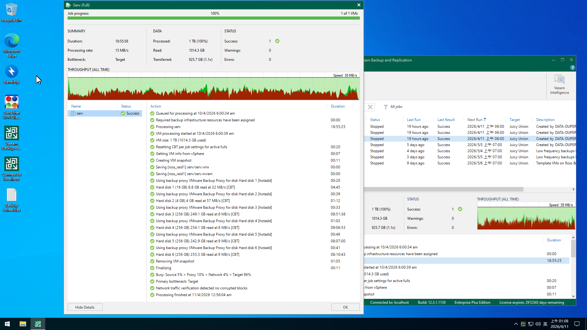
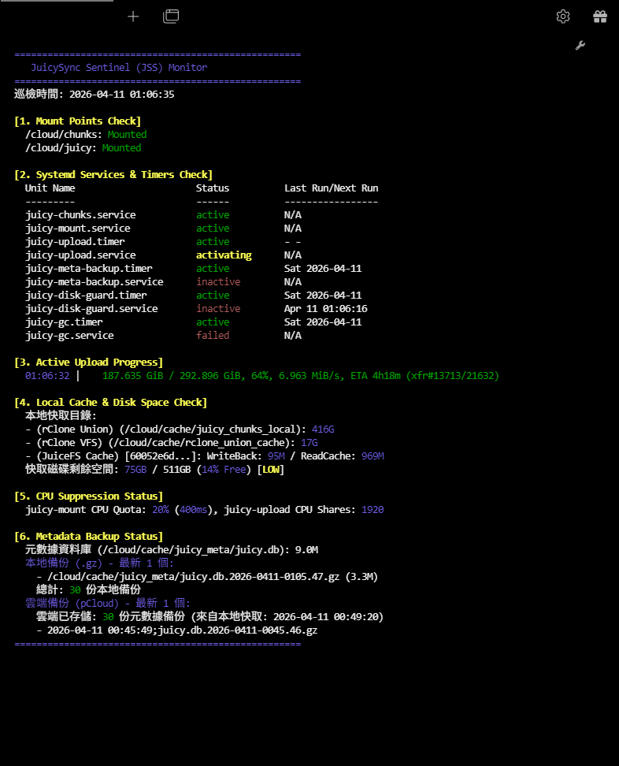
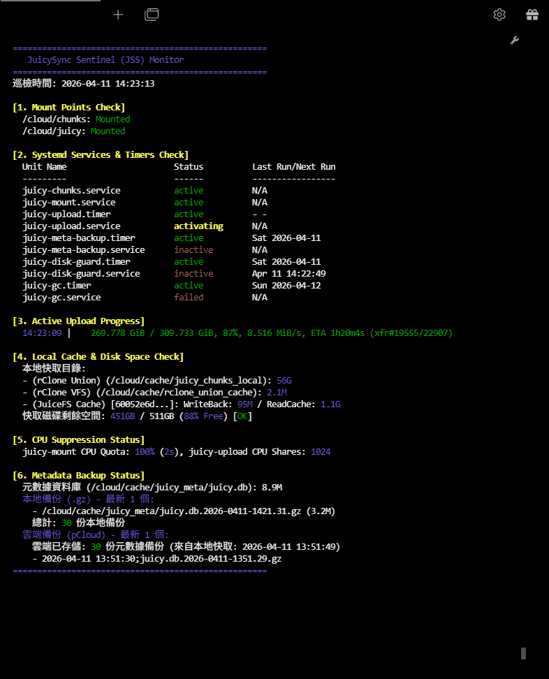

# JuicySyncSentinel
JuicySync Sentinel 是一套基於 JuiceFS 與 Rclone 的雲端存儲掛載方案，面向 pCloud 10T 做為備份空間，利用 512G 本地空間，應付 Veeam Backup &amp; Replication 單次備份達 1T 以上的 VM。以最少的成本做到企業級的功能。

由於 pCloud 的 Client，寫入多大的檔案就要有多大暫存空間，對於備份系統不切實際，所以需要一個中繼伺服器做為暫存。
而 pCloud 上傳速度有限，最高 12MB/sec, 均速 8MB/sec, Veeam 無法直接對接 pCloud，備份檔無法分割，也無法限速，讀多少，網路頻寬有多少，就寫多少出去，很容易就把中繼伺服器寫爆，檔案大小也是大問題。
所以中繼伺服器配置 JuiceFS, 用來將檔案切割為 16MB chunk, 利用 rClone 傳輸到 pCloud，並且依照空間剩餘量，調整 JuiceFS 的 process 的 CPUQuota 與 CPUShares 以平衡「寫入速度」與「上傳能力」，這樣的配置可以應付 1T 的 VM 備份。缺點是由於 pCloud 端的備份檔儲存的是 Chunk 碎塊，無法直接使用，必須透過 JuiceFS 才能還原檔案。

我的 1T VM 備份總讀取時間少於 24 小時， 36 可完全上傳完畢，完成 1T VM 備份，符合均速 8MB/sec 的 pCloud 上傳頻寬。

中繼伺服器硬體配置：4 cores, 4G RAM, 4G Swap, 512G HDD, AlmaLinux 9 minimal installation. 由於 JuiceFS 開啟壓縮，故核心數配置較多。

初始化 JuiceFS 資料庫指令：
```text
/usr/local/bin/juicefs format \
    --storage file \
    --bucket /cloud/chunks \
    --block-size 16384 \
    --compress lz4 \
    --trash-days 0 \
    redis://127.0.0.1:6379/1 \
    juicy-chunks
```

2026年某時間後，不知為何，juicy-gc 無法對 pcloud 做刪除 Trash 的動作，應為 pCloud API 更改，禁止刪除 Trash。必須上 pCloud 手動刪除 Trash，否則時間一久，Trash 被塞爆會造成 pCloud 網頁打不開，就要找 pCloud 客服處理了。

## 螢幕截圖
# Windows, Veeam


# Linux, jstat


# Linux, jstat


以上是人類寫的

---
以下99.9趴都是 AI 寫的，包含所有系統檔案，名字也是AI取的。文件可能詞不達意，畢竟是AI，系統檔都是部署運作中，都沒問題。

---

這是一份針對最新配置（包含 **MergerFS**、**Redis 元數據引擎**、**動態 Resource Guard** 與全套 Systemd 服務）全面重新整理並重構的 **JuicySync Sentinel (JSS)** 系統說明文件。

本文件已嚴格根據您提供的所有現行 `.service` / `.timer` 腳本與全新架構進行編修，完全可直接作為專案的主說明文件使用：

---

# JuicySync Sentinel (JSS) 系統說明文件

**版本**：v2.1 (JuiceFS + Redis + MergerFS + rClone + pCloud)

**更新日期**：2026 年 10 月

**適用環境**：AlmaLinux 9 (4 Core CPU, 4GB RAM, 4G SWAP, 512GB storage, FUSE 3)

---

## 一、 架構設計與整體功能說明

**JuicySync Sentinel (JSS)** 是一套具備動態資源自我調節能力的高效能雲端混合儲存方案。系統結合了 **JuiceFS** 的強大元數據分塊管理與 **MergerFS** 的本地/雲端聯合掛載特性，專為 Veeam Backup & Replication 等大容量備份需求（支援單檔 1TB+）所設計。它成功將有限的 512GB 本地快取 HDD 轉化為高達 10TB 的 pCloud 備援儲存空間。

### 核心功能亮點：

1. **MergerFS 零延遲寫入**：透過 MergerFS 的 `-o category.create=ff` 策略，所有來自 JuiceFS 的新 Chunk 資料塊均 100% 強制先落在本地 HDD（`/cloud/cache/juicy_chunks_local`），確保 Veeam 備份任務不因網路波動作而拋出 Timeout。


2. **非同步背景數據流動**：系統每 60 秒透過 `rclone move` 自動將本地滿 20 秒以上的 Chunks 搬移至 pCloud，並在刪除本地檔案後由 MergerFS 透明切換至遠端掛載點（`/cloud/juicy_chunks_remote`），達成「實時本地寫入、背景定時同步」。


3. **雲端按需區塊預讀 (Sparse VFS)**：遠端 Rclone 掛載採用 `--vfs-cache-mode full`，支援稀疏檔案（Sparse File）技術，JuiceFS 在讀取歷史備份時僅會按需下載所需的 Block，絕不浪費頻寬與本地快取。


4. **極致動態資源護衛 (Disk Guard)**：針對 512GB 本地空間限制，系統每分鐘監控本地剩餘空間，依據階梯式演算法自動微調 JuiceFS 的 `CPUQuota` 與上傳服務的 `CPUWeight`，確保磁碟空間越低時，上傳優先權越高，保護磁碟不致塞爆。


5. **高效 Redis 元數據與雙備份機制**：將 JuiceFS 元數據引擎由 SQLite 升級為本地 **Redis**，大幅降低檔案操作延遲；每 5 分鐘自動執行 `juicefs dump` 壓縮備份並同步至 pCloud，本地與雲端各精確保留最新的 30 份副本。


---

## 二、 最新系統功能方塊圖 (Architecture Block Diagram)

```text
[ Veeam Backup & Replication ] (data rate 100 MB/s max)
            │
            ▼ (POSIX Mount)
+-------------------------------------------------------------------+
|               1. JuiceFS 掛載點 (/cloud/juicy)                   | <--- [ Local Redis Metadata ]
|     (--writeback, --cache-dir /cloud/cache/jfsCache)            |      (redis://127.0.0.1:6379/1)
+-------------------------------------------------------------------+      (每5分鐘 dump 備份至 pCloud)
            │
            ▼ (Chunk 讀寫要求, /cloud/chunks)
+-------------------------------------------------------------------+
|            2. MergerFS 聯合掛載點 (/cloud/chunks)                |
|           (-o category.create=epmfs, -o func.getattr=newest)      |
+---------------------------------+---------------------------------+
                                  │
         ┌────────────────────────┴────────────────────────┐
         │ (RW: 新建與寫入優先)                            │ (NC: 不新增)
         ▼                                                 ▼
+----------------------------------+     +----------------------------------+
| 3a. 本地寫入緩衝區 (Local HDD)    |     | 3b. Rclone pCloud 不新增掛載點     |
| (/cloud/cache/juicy_chunks_local)|     | (/cloud/juicy_chunks_remote)     |
+----------------------------------+     +----------------------------------+
         │                                                 │
         │ (rclone move 每60s背景搬移, --min-age 20s)      │ (VFS full 模式, 稀疏檔按需預讀)
         ▼                                                 │
+----------------------------------------------------------+--------+
| 4. pCloud 遠端儲存 (pcloud_ecstasy0:/rclone/juicy_chunks)        |
|                            (10TB 總容量)                          |
+-------------------------------------------------------------------+

```

---

## 三、 各 Systemd 服務與組件說明

所有 Systemd 服務檔均納入 `juicy-mount.service` 的 `PartOf` 聯動生命週期管理：

### 1. 核心掛載與儲存層服務

* **`juicy-chunks-remote.service`**：
使用 Rclone 將 pCloud 遠端目錄掛載至 `/cloud/juicy_chunks_remote`。開啟 `--vfs-cache-mode full` 以支援稀疏檔案與按需區塊下載。


* **`juicy-chunks-union.service`**：
使用 **MergerFS** 將本地 `/cloud/cache/juicy_chunks_local` (RW) 與遠端 `/cloud/juicy_chunks_remote` (NC) 聯合掛載至 `/cloud/chunks`。設定 `category.create=epmfs` 確保寫入與父目錄建置 100% 發生在本地。


* **`juicy-mount.service`**：
**系統主服務**。負責啟動 JuiceFS 並連線至本地 Redis 元數據引擎，將 `/cloud/chunks` 包裝為標準 POSIX 掛載點 `/cloud/juicy` 供 Veeam 使用。開啟 `--writeback` 加速寫入。


### 2. 資料流動與空間守護

* **`juicy-upload.service` & `.timer**`：
數據移動器。每 60 秒執行一次 `rclone move`，將本地快取中修改時間超過 20 秒的 Chunks 移動至 pCloud，並刪除空的來源目錄。


* **`juicy-disk-guard.service` & `.timer**`：
**動態資源護衛哨兵**。每分鐘檢測本地 HDD 剩餘空間（`RAW_FREE`），依據 25G~500G 的階梯矩陣動態設定 `juicy-mount.service` 的 `CPUQuota` (1%~100%) 與 `juicy-upload.service` 的 `CPUWeight` (100~2000)。


### 3. 元數據維護與垃圾回收

* **`juicy-meta-backup.service` & `.timer**`：
每 5 分鐘執行一次。透過 `juicefs dump` 將 Redis 中的元數據匯出並用 `gzip` 壓縮，同步上傳至 pCloud（`pcloud_ecstasy0:/rclone/direct/juicy_meta/`），本地與雲端均自動刪除舊檔並各精確保留最新 30 份副本。


* **`juicy-gc.service` & `.timer**`：
每日凌晨 03:00 執行。觸發 JuiceFS 核心垃圾回收（`juicefs gc --delete`）、執行 Redis 記憶體重組（`MEMORY PURGE` / `BGREWRITEAOF`）、清理超過 30 天的本地 Dump 檔與 pCloud 上超過 24 小時的 `.partial` 上傳暫存檔。


---

## 四、 完整部署指引 (AlmaLinux 9)

### 1. 基礎相依性與 Redis 安裝

```bash
# 1. 安裝 FUSE3, SQLite, Gzip, Redis 與相關工具
sudo dnf install fuse3 sqlite gzip redis -y

# 2. 啟動並設定 Redis 開機自動執行
sudo systemctl enable --now redis

```

### 2. 建立目錄結構與路徑權限

```bash
# 建立所有必要之掛載與快取目錄
sudo mkdir -p /cloud/juicy \
              /cloud/chunks \
              /cloud/juicy_chunks_remote \
              /cloud/cache/jfsCache \
              /cloud/cache/rclone_cache \
              /cloud/cache/juicy_meta \
              /cloud/cache/juicy_chunks_local \
              /var/log/juicy

# 調整日誌寫入權限
sudo chmod 755 /var/log/juicy

```

### 3. 配置檔部署

1. 確保 Rclone 配置檔已放置於 `/home/cmm/.config/rclone/rclone.conf`。


2. 將所有 `.service` 與 `.timer` 檔案複製至 `/etc/systemd/system/`。


### 4. 服務啟動與驗證

```bash
# 重新載入 Systemd
sudo systemctl daemon-reload

# 啟動 JSS 主服務 (自動重連所有依賴服務與計時器)
sudo systemctl enable --now juicy-mount.service

# 檢查狀態與掛載點
df -h /cloud/juicy /cloud/chunks
systemctl list-timers "juicy*"

```

---

## 五、 運作風險評估與防範機制

| 風險場景 | 潛在影響 | JSS 內建防護與應對機制 |
| --- | --- | --- |
| **備份寫入速度大於網路上傳速度** | 本地 HDD (512GB) 空間被逐步耗盡。 | **Juicy Disk Guard 護衛機制**：當空間降至 50GB 以下時，JuiceFS 的 CPU 配額會被壓縮至 <=20%，同時提高 Upload 的 CPUWeight 至 1000+，強行壓制寫入並全力保障上傳頻寬。

 |
| **突發斷電導致元數據遺失** | Redis 記憶體資料未及時寫入硬碟。 | **雙重保護**：Redis 本身開啟 AOF 持久化；`juicy-meta-backup` 每 5 分鐘進行一次 `juicefs dump` 並同步備份至 pCloud，可在秒級內完成重組復原。

 |
| **網路中斷或 pCloud API 異常** | 數據暫存在本地無法上傳。 | `rclone move` 開啟 `--ignore-errors` 與重試邏輯；MergerFS 保障只要本地 HDD 還有空間，Veeam 寫入完全不受影響。

 |
| **網絡異常中斷導致 Chunk 上傳半途殘留** | 雲端累積無用的暫存檔。 | `juicy-gc.service` 每日自動清理 pCloud 上超過 24 小時的 `.partial` 檔案。

 |